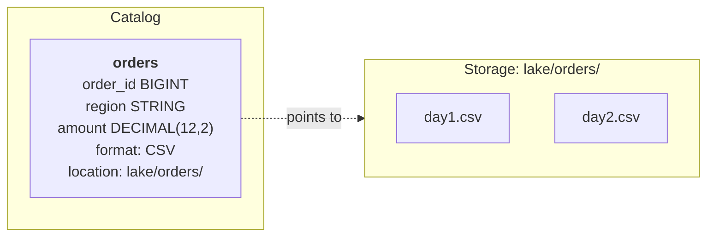

A data lake stores ==**structured, semi-structured and unstructured** data== as files on cheap object storage, in ==open file formats== (e.g. [[Parquet]], ORC, Avro, JSON, CSV).
- Data is **stored as-is**: nothing has to be modelled, typed or transformed before it is written. 
### Key capabilities
- Store raw data cheaply at scale.
- Hold every kind of data in one place
- Just store the data first, thing about how to transform later on
- Keep raw data for later. It can be transformed for uses nobody knew about when it was written, and reprocessed when transformation logic changes.
- [[ELT (Extract, Load, Transform)]], transformed data is written & [[ETL (Extract, Transform, Load)]], raw data is landed: **Both works with a Data Lake.**
### How it works [[Schema On Read]]
1. Save files to a location in the data lake
	- Nothing is required, checked, converted at write time. The file stays exactly as written.
	- Any ==mismatch shows up only when a query reads it==
2. Register a ==table definition== for that location in the catalog, to ==query the files as a table==

	- Declare the location, columns, types, file format etc.
	- It can be created before or after files are written
3. When querying `orders` (table in the catalog)
	- The catalog, will retrieve the definition (Everything that was declared when the table was registered) for the table `orders`. It will get the schema, location etc.
	- Reads the files using the declared file format, and uses the schema to decide what each value means (e.g. “the third field is `amount`, a number”).
4. Nothing checks that the files matches the schema, so the query might fail, return `NULL` or the wrong value
### Catalog
```
Catalog
├── sales                  ← database: a named group
│   ├── orders             ← table definition
│   └── customers          ← table definition
└── marketing              ← database
    ├── campaigns
    └── orders             ← allowed: different database, so a different full name
```
A service that stores ==table definitions== for the data lake, organized by database and table name (e.g. `sales.orders`). Query engines ask it for a table's definition by name.

**Table Definitions**: 
```sql
-- To create a table definition
CREATE EXTERNAL TABLE sales.orders_raw (
  order_id BIGINT,
  region   STRING,
  amount   DECIMAL(12,2)
)
ROW FORMAT DELIMITED
FIELDS TERMINATED BY ','
STORED AS TEXTFILE
LOCATION 's3://lake/raw/orders/'
TBLPROPERTIES ('skip.header.line.count' = '1');
```
- the schema: column names and types
- the file format
- the location: the folder holding the table's files
- partitions and their folders (for partitioned tables)
	- Uses the [[Hive Style Partition]]
- depending on the catalog: access permissions and statistics
### Limitations
- **No checks at write:** correctness depends on every writer producing what the definition expects.
- **No transactions:** while a job is rewriting files, a query can read a mix of old and new files.
- **Data swamp:** without up-to-date definitions and an owner for each dataset, files pile up that nobody can find or trust.
[[Lakehouse Table Format]] address the first two by adding schema enforcement and atomic commits on top of lake storage.